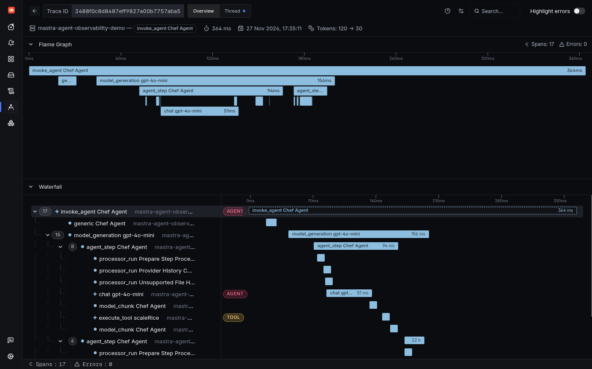
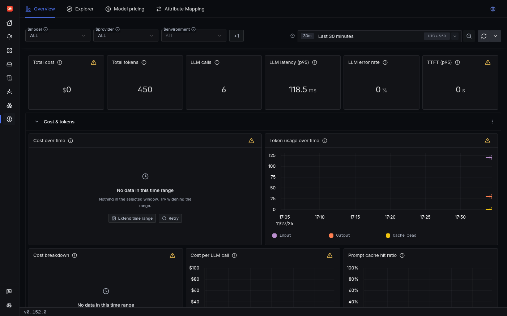

# Mastra Agent Observability Demo

Run a Mastra chef agent that calls a tool to calculate how much dry rice to cook. Mastra records the agent run, model calls, and tool call. The OpenTelemetry exporter sends those spans to SigNoz over OTLP/HTTP.

## Stack

- Node.js 22.18 or newer
- `@mastra/core` 1.86.0, `@mastra/observability` 1.24.3, and `@mastra/otel-exporter` 1.6.2
- `@opentelemetry/exporter-trace-otlp-proto` 0.223.2
- OpenAI `gpt-4o-mini`

## Run it

```sh
cd nodejs/mastra-agent-observability-demo
npm ci
cp .env.example .env
```

Set `OPENAI_API_KEY` in `.env` and configure one telemetry destination.

- **SigNoz Cloud**. Set `SIGNOZ_INGESTION_KEY` and `SIGNOZ_REGION` (`us`, `eu`, or `in`).
- **Self-hosted SigNoz**. Set `OTEL_EXPORTER_OTLP_TRACES_ENDPOINT=http://127.0.0.1:4318/v1/traces` for a collector on the same machine. Use the full OTLP/HTTP traces URL for your collector. [Install SigNoz on Docker](https://signoz.io/docs/install/docker/).

```sh
npm run check
npm start
```

The agent should answer that three servings need 225 grams of dry rice. The process shuts down Mastra after the run so it can flush telemetry.

## What to look for

1. In **Traces**, filter by `service.name = mastra-agent-observability-demo` and open the `invoke_agent Chef Agent` trace. Look for the model spans and the `execute_tool scaleRice` span.
2. In **More → AI Observability**, select the same service and a time range that includes the run. Look for model calls, token usage, latency, and tool calls. For cost panels, [configure model pricing](https://signoz.io/docs/ai-observability-model-pricing/).

## Instrumentation

The demo registers an `Observability` instance from `@mastra/observability` with Mastra. Mastra instruments the agent, model, and tool automatically. The exporter sends traces with `service.name` and `deployment.environment.name`. The sample uses a fixed, non-sensitive prompt.

## Screenshots

Captured with self-hosted SigNoz v0.152.0 and a deterministic OpenAI-compatible model fixture.




